# CardForge: analysis diagrams

Diagrams of the CardForge app and the card-sorting machine. They are written in
Mermaid, so the code can be edited and versioned with the project. They render on
GitHub, GitLab and in VS Code (with the Markdown Preview Mermaid Support
extension); you can also paste the code into mermaid.live.

Mermaid has no UML activity or use-case symbols, so those diagrams are drawn as
flowcharts: a diamond is a decision, an oval is a use case, a rectangle is an
action.

## 1. System context

Who talks to whom. Dashed lines are communication still to be confirmed.

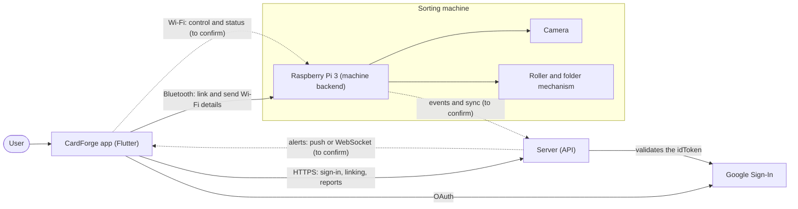

## 2. Use cases

What each actor does with the system. The machine is an actor because it receives
commands and sends events.

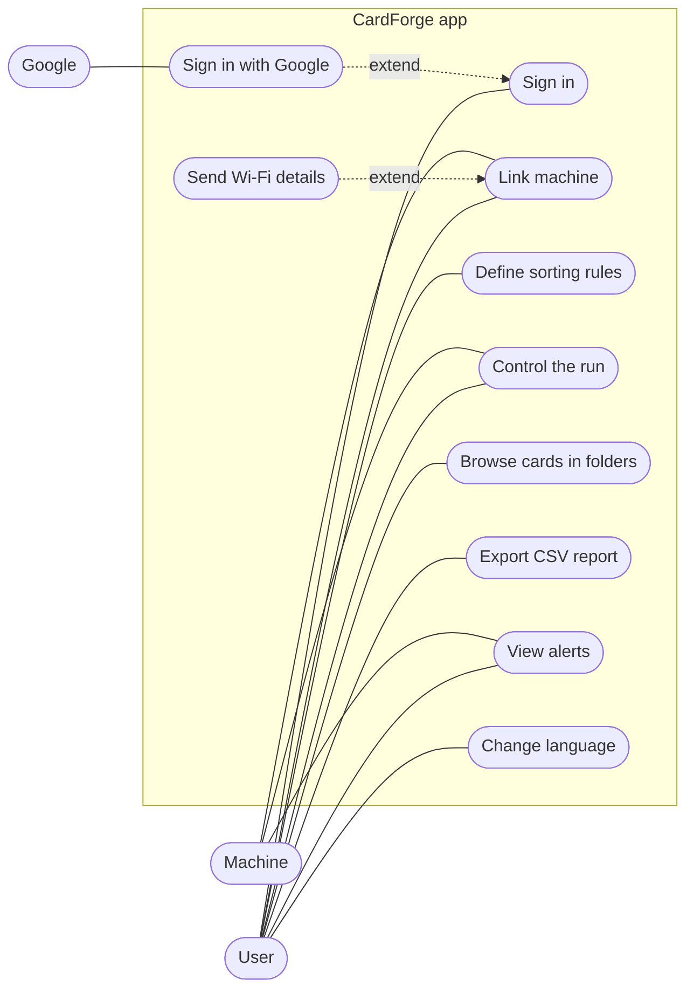

## 3. Activity: startup and sign-in

Implemented flow: Splash, server check and sign-in with a password or Google,
with the option to remember the session.

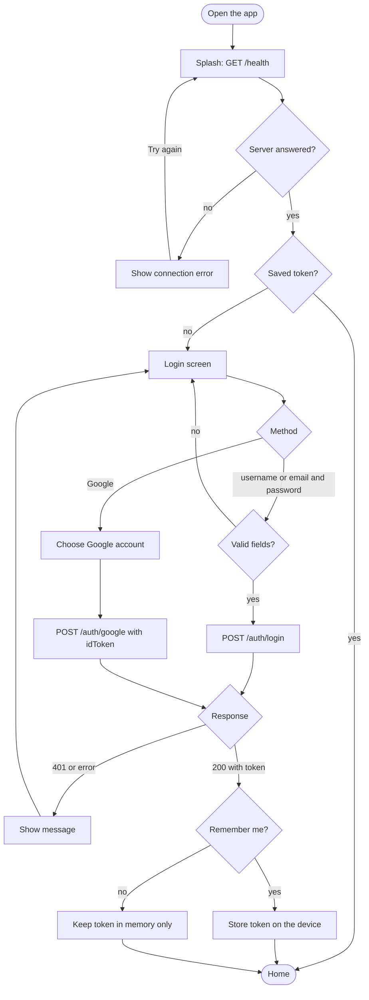

## 4. Activity: link a machine

Implemented flow (Bluetooth is simulated for now): scan, pick a machine, machine
password, optional Wi-Fi details and an asynchronous confirmation.

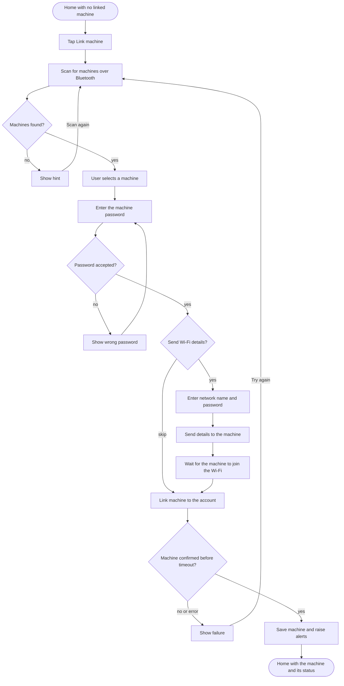

## 5. Activity: card sorting cycle

The physical process, card by card, with the exceptions that raise an alert in the
app.

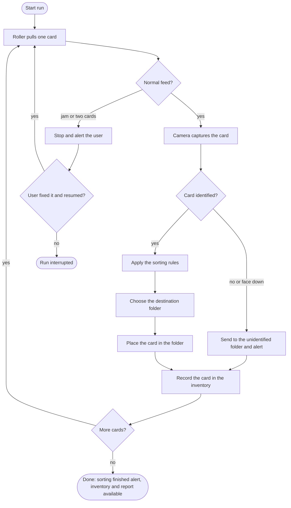

## 6. Run states

Life cycle of a machine run, as the app sees it.

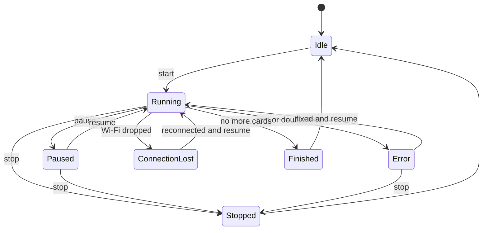

## 7. Sequence: Google sign-in

Messages between the app, Google and the server. This is the flow implemented in
`AuthService`.

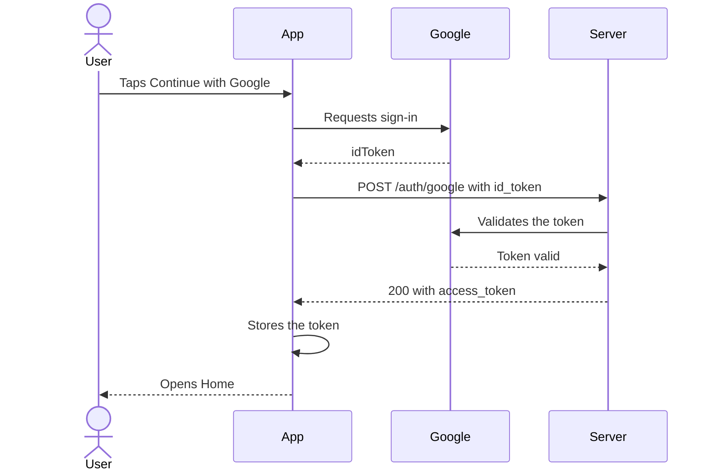

## 8. Sequence: link the machine (simplified)

Three actors: smartphone, machine and server. The status coming back through the
server is an assumption.

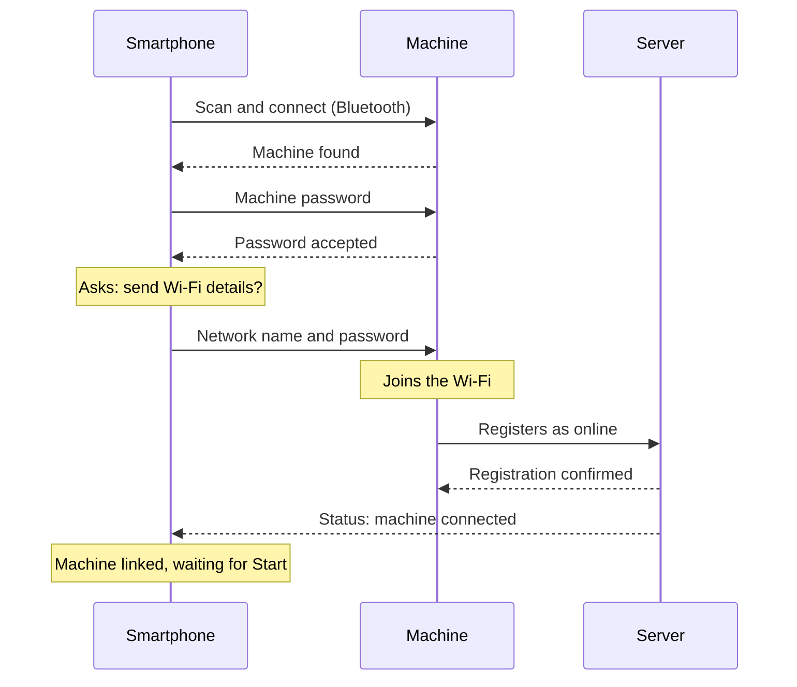

## 9. Sequence: sorting run (simplified)

After Start, the machine repeats the cycle for each card. Routing the Start
command through the server is an assumption.

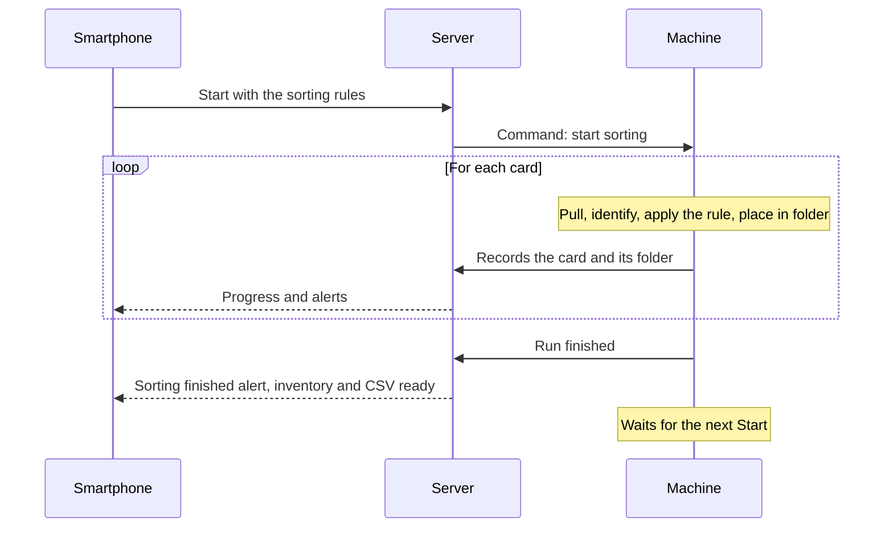

## 10. Sequence: alerts

How an event reaches the user. The server channel (push, WebSocket or polling) is
still to be decided; the app side is implemented (`AlertsController.add`).

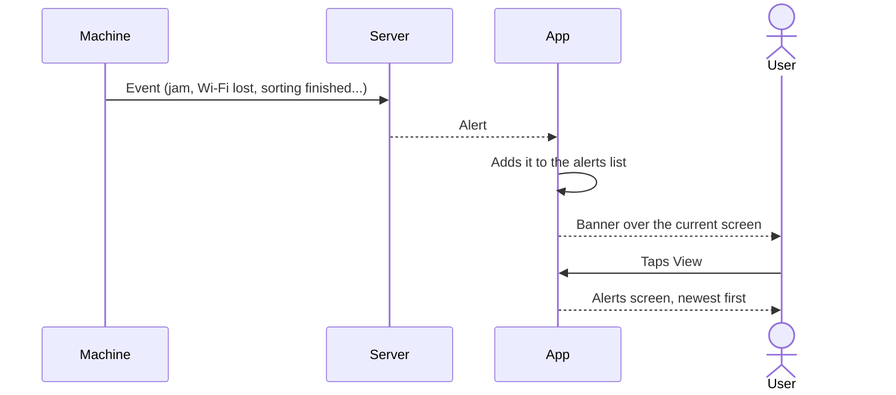

## 11. Data model (proposal)

Conceptual entities for the server and the inventory. A starting point to validate
with the backend.

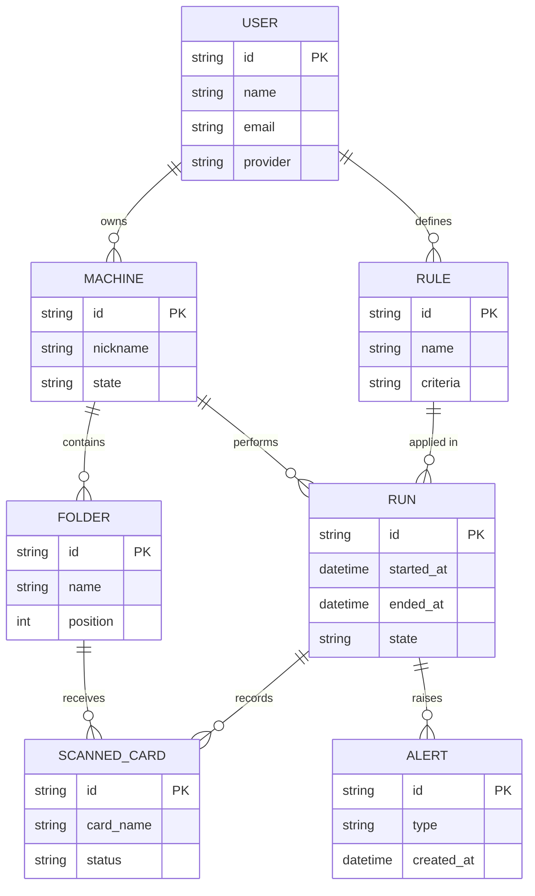

## 12. Sequence: search cards in folders

How the Cards in folders screen gets its data. Nothing typed lists every card;
typing a name lists the matching cards and the folders each one is in.

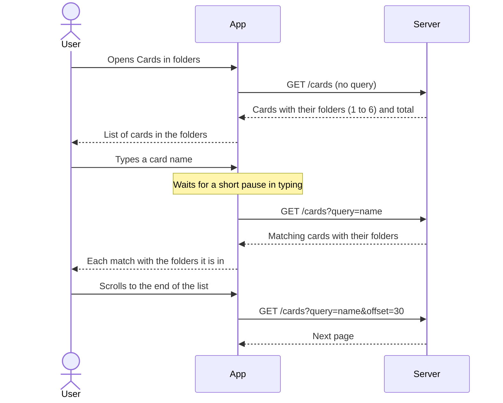

## Assumptions and open points

- During a run the app may talk directly to the Raspberry over local Wi-Fi, or
  everything may go through the server. It is dashed in diagram 1 until
  confirmed.
- The real Bluetooth protocol (BLE or classic, service identifiers and message
  format) is not defined yet, so the app uses a simulated machine.
- Unidentified or face-down cards go to a folder of their own and raise an alert.
- The inventory and the report are only available after the run finishes.
- Losing the connection pauses the run, and the user resumes it from the app.
- The data model in diagram 11 is an initial proposal, not yet validated.
